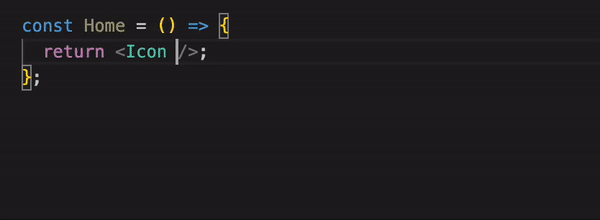

# Typed React Native Vector Icons

Fully typed Icon component for react-native-vector-icons.




## Getting Started

1. Install react-native-vector-icons

2. Install this package
```bash
yarn add react-native-easy-icon
```

## What if react-native-vector-icons add new icon sets or icons?
Follow these steps:
```bash
# 1. Install dependencies
yarn add react-native-easy-icon

# 2. Add new icon set to index.tsx > IconSets array

# 3. Generate a typed Icon component by parsing react-native-vector-icons package.
yarn generate

# 4. Build
yarn build
```


## How does it works?

The generation script:
1. For each icon set (AntDesign, Zocial, Entypo, etc), find the glyph map file by reading each `./node_modules/react-native-vector-icons/${iconSetName}.js`
    - Example from Feather.js:
    ```javascript
    import createIconSet from './lib/create-icon-set';
    import glyphMap from './glyphmaps/Feather.json'; // the script gets this path.
    // ...
    ```
    - We cannot assume that the glyph map file path is `.../glyphmaps/${iconSetName}.json` because FontAwesome5 is an exception.
2. Get list of icon names of each icon set by parsing glyph map files.
    - Example from glyphmaps/Feather.json:
    ```json
    {
        "activity": 61696,
        "airplay": 61697,
        "alert-circle": 61698,
        //...
    }
    ```
3. Generate `${iconSetName}.d.ts` in `src/types/` for each icon set.
    - Example of Feather.d.ts:
    ```typescript
    const FeatherIcons = ["activity","airplay","alert-circle",...]
    type FeatherIcon = (typeof FeatherIcons)[number]
    ```
4. Generate an Icon component in `src/Icon.tsx`.